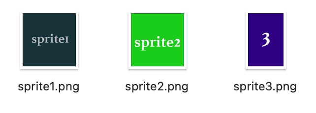
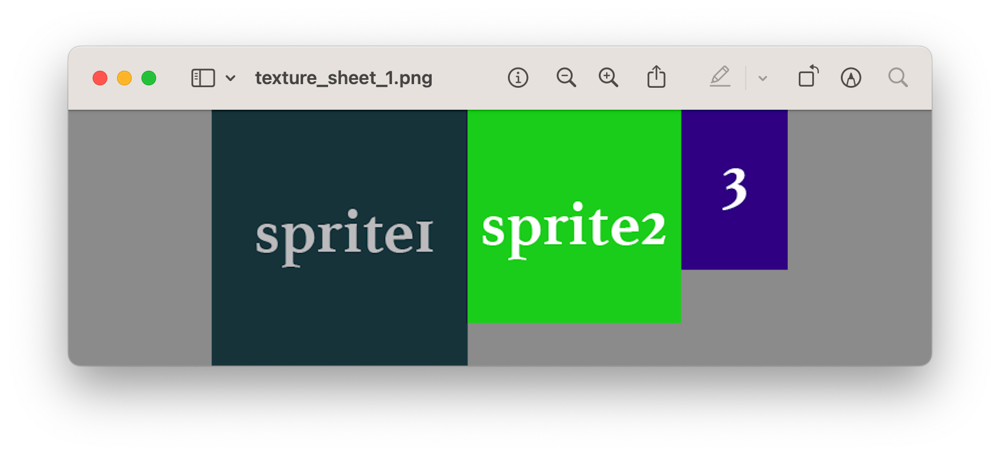

# Open Texture Packer

[English](README.md) | 日本語

Rust 製の、オープンソースで無料の Texture Packer ツールです。


## インストール

### Homebrew

```
brew tap webcyou-org/tap
brew install open-texture-packer
```

### Cargo

```
cargo install open_texture_packer
```

インストールすると `otp` コマンドが使えるようになります。

```
otp <任意のオプション>
```

### Rust

```
cargo add open_texture_packer
```

```
[dependencies]
open_texture_packer = "0.4.0"
```

## 基本的な使い方

テクスチャにまとめる画像が入ったディレクトリのパスを指定します。

```
otp <input_directory>
```

出力先のディレクトリも指定できます。

```
otp <input_directory> [output_directory]
```

何も指定しない場合は、カレントディレクトリの画像を読み込みます。

```
otp
```

開発環境では `cargo run` でも実行できます。

```
cargo run <input_directory>
cargo run <input_directory> [output_directory]
cargo run
```

### 実行結果

サイズの異なる3つのスプライト（sprite1.png、sprite2.png、sprite3.png）があるディレクトリで実行した場合の例です。



出力先に次のファイルが生成されます。

```
texture_sheet_1.css
texture_sheet_1.json
texture_sheet_1.png
```

`texture_sheet_1.png` は、次のように1枚にまとめられたテクスチャ画像です。




### パッキングアルゴリズム

`--algorithm`（`-a`）でアルゴリズムを選択します。既定は `next-fit` です。

```
otp <input_directory> [output_directory] --algorithm skyline
```

| `--algorithm` | スプライトの順序 | 配置先 |
|---|---|---|
| `next-fit` | 入力順 | 現在の棚のみ。シートの最大幅で1回だけ処理します |
| `shelf-packing` | 高さの降順 | 現在の棚のみ |
| `first-fit` | 入力順 | 空きのある最初の棚 |
| `first-fit-decreasing` | 高さの降順 | 空きのある最初の棚 |
| `best-fit` | 入力順 | 高さが最も近い棚。同じなら隙間が最小の棚 |
| `skyline` | 高さの降順 | スカイライン上で上端が最も低くなる位置（Bottom-Left） |
| `maximal-rectangles` | 面積の降順 | 短辺側の余りが最小の空き領域（Best Short Side Fit） |

`next-fit` 以外のアルゴリズムは、より狭いシート幅も試し、シート枚数が最も少なく、その中で面積が最小の配置を採用します。

各シートの JSON と CSS では、スプライトは入力順のままです。そのため、アニメーションのフレームは元の順番で再生されます。

次のアルゴリズムは今後追加する予定です。

- Worst Fit
- Best Fit Decreasing
- Guillotine Cutting

### ライブラリ

`pack_rects` は画像を読み込まず、サイズだけで配置を計算します。`compare_algorithms` は同じ入力を全アルゴリズムで処理します。

```rust
use open_texture_packer::{compare_algorithms, pack_rects, PackingAlgorithm};

let sizes = [(64, 64), (32, 128), (96, 48)];

let result = pack_rects(&sizes, PackingAlgorithm::Skyline, 4096, 4096)?;
for placement in &result.sheets[0].placements {
    println!("#{} at ({}, {})", placement.index, placement.x, placement.y);
}

for result in compare_algorithms(&sizes, 4096, 4096)? {
    println!("{}: {:.1}%", result.algorithm, result.occupancy() * 100.0);
}
```

`pack_sprites` は、読み込み済みの `Sprite` に対して同じ処理を行い、そのまま書き出せる `SpriteSheet` を返します。

#### 回転

`pack_rects_with` はオプションを受け取ります。`allow_rotation` を指定すると、Skyline と Maximal Rectangles は、詰めやすい場合にスプライトを時計回りに 90 度回転させます。棚系のアルゴリズムはこの指定を無視し、回転しません（`PackingAlgorithm::supports_rotation`）。

```rust
use open_texture_packer::{pack_rects_with, PackOptions, PackingAlgorithm};

let options = PackOptions { allow_rotation: true };
let result = pack_rects_with(&sizes, PackingAlgorithm::MaximalRectangles, 4096, 4096, options)?;
for placement in &result.sheets[0].placements {
    // width と height はシート上のサイズで、回転時は入れ替わります。
    println!("#{} rotated: {}", placement.index, placement.rotated);
}
```

回転したスプライトの元の左上の角は、配置先の右上にあります。`compare_algorithms_with` は同じオプションで全アルゴリズムを比較します。`pack_sprites` と `otp` コマンドは回転しません。

## Web

パッキングエンジンはブラウザでも動作します。[デモページ](https://webcyou-org.github.io/open-texture-packer/)では、`examples/assets` のスプライトで全アルゴリズムの結果を比較できます。

WebAssembly ビルドが行うのは配置の計算だけです。画像のデコードと描画はブラウザに任せます。

```js
import init, { packRects } from "./pkg/open_texture_packer_wasm.js";

await init();

const result = packRects(
  [{ width: 64, height: 64 }, { width: 32, height: 128 }],
  "skyline",
  4096,
  4096,
);

for (const sheet of result.sheets) {
  for (const { index, x, y, width, height } of sheet.placements) {
    // sheet.width x sheet.height の canvas の (x, y) に、画像 index を描画します。
  }
}
```

スプライトを配置できない場合、`packRects` は例外を投げます。`compareAlgorithms(sizes, maxWidth, maxHeight)` は全アルゴリズムの結果を返し、`algorithms()` はアルゴリズムの ID と名前の一覧を返します。各結果には `usedArea`、`sheetArea`、`occupancy` も含まれます。

Rust では、コマンドラインツールと画像処理を除いて、エンジンだけを利用することもできます。

```toml
open_texture_packer = { version = "0.3", default-features = false }
```

## 開発

### テスト

```
cargo test
cargo build --no-default-features
wasm-pack test --node wasm
```

### デモページ

サイトは `docs/` から配信します。`build-docs.sh` は `docs/pkg`（WebAssembly ビルド）と `docs/assets`（`examples/assets` のコピーと `manifest.json`）を再生成します。パッキングエンジン、wasm バインディング、スプライトを変更したら実行し、結果をコミットしてください。`docs/index.html`、`docs/app.js`、`docs/style.css` は手で編集します。

```
./scripts/build-docs.sh
python3 -m http.server -d docs
```

その後、<http://localhost:8000> を開きます。公開するには、Settings > Pages で `main` ブランチの `/docs` フォルダを配信元に設定します。以降は `main` に push するとサイトが更新されます。

### リリース

`cargo login` と、このリポジトリおよび [homebrew-tap](https://github.com/webcyou-org/homebrew-tap) への push 権限が必要です。クリーンで最新の `main` から始めてください。

1. バージョンを公開します。`release.sh` は `Cargo.toml`、`Cargo.lock`、両方の README のバージョンを更新し、テストと公開の dry-run を実行してから確認を求めます。その後、コミット、`main` の push、`cargo publish`、tag の push を行います。

   ```
   ./scripts/release.sh 0.3.1
   ```

2. tag の push で [Build and Release](.github/workflows/release.yml) ワークフローが動き、Linux、macOS（Intel と Apple Silicon）、Windows のバイナリが GitHub Releases にアップロードされます。

3. Homebrew の Formula を更新します。`update-formula.sh` は macOS のバイナリを待ち、Formula の変更を表示して、確認後に push します。

   ```
   ./scripts/update-formula.sh 0.3.1
   ```

途中で失敗した場合は、原因を解消して同じコマンドを再実行してください。完了済みの手順は飛ばされます。

crates.io に公開したバージョンは置き換えも削除もできず、yank しかできません。必ず tag の push より先に公開してください。`release.sh` はこの順番で実行します。

## 作者

**Daisuke Takayama**
* [@webcyou](https://twitter.com/webcyou)
* [@panicdragon](https://twitter.com/panicdragon)
* <https://github.com/webcyou>
* <https://github.com/webcyou-org>
* <https://github.com/panicdragon>
* <https://www.webcyou.com/>

### ライセンス

Copyright (c) 2024 Daisuke Takayama
[MIT ライセンス](http://opensource.org/licenses/mit-license.php)のもとで公開しています。
