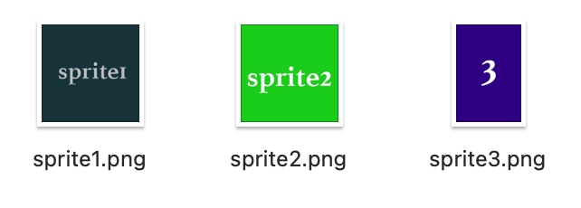
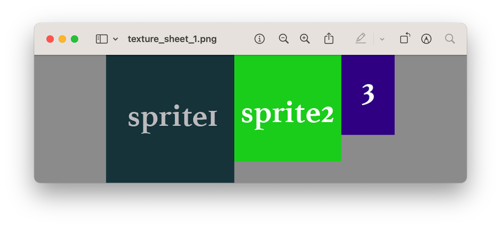

# Open Texture Packer

Open source and free Texture Packer tool written in rust.


## Installation

### Home Brew

```
brew tap webcyou-org/tap
brew install open-texture-packer
```

### Cargo

```
cargo install open_texture_packer
```

The otp command is available upon installation.

```
otp <any option>
```

### Rust

```
cargo add open_texture_packer
```

```
[dependencies]
open_texture_packer = "0.3.1"
```

## Basic Usage

Specifies the path of the directory containing the images to be textured.

```
otp <input_directory>
```

You can also specify an arbitrary directory for the output destination

```
otp <input_directory> [output_directory]
```

If nothing is specified, images in the current directory are retrieved.

```
otp
```

In the development environment, it can also be run with cargo run.

```
cargo run <input_directory>
cargo run <input_directory> [output_directory]
cargo run
```

### Result - Basic Usage

When performed when three sprites (sprite1.png, sprite2.png, sprite3.png) of different sizes are present in a directory



The following files are generated in the output

```
texture_sheet_1.css
texture_sheet_1.json
texture_sheet_1.png
```

The texture_sheet_1.png is merged to produce a texture image as follows




### Packing Algorithm

Select an algorithm with `--algorithm` (`-a`). The default is `next-fit`.

```
otp <input_directory> [output_directory] --algorithm skyline
```

| `--algorithm` | Sprite order | Placement |
|---|---|---|
| `next-fit` | Input | Current shelf only. A single pass at the full sheet width |
| `shelf-packing` | Height, descending | Current shelf only |
| `first-fit` | Input | First shelf with room |
| `first-fit-decreasing` | Height, descending | First shelf with room |
| `best-fit` | Input | Shelf with the closest height, then the tightest gap |
| `skyline` | Height, descending | Lowest top edge on the skyline (Bottom-Left) |
| `maximal-rectangles` | Area, descending | Free rectangle with the smallest short-side gap (Best Short Side Fit) |

All algorithms except `next-fit` also try narrower sheet widths and keep the layout with the fewest sheets and the smallest area.

On each sheet, sprites stay in input order in the JSON and CSS output, so animation frames play in the original sequence.

The following algorithms are planned:

- Worst Fit
- Best Fit Decreasing
- Guillotine Cutting

### Library

`pack_rects` works on plain sizes, without loading images. `compare_algorithms` runs every algorithm on the same input.

```rust
use open_texture_packer::{compare_algorithms, pack_rects, PackingAlgorithm};

let sizes = [(64, 64), (32, 128), (96, 48)];

let result = pack_rects(&sizes, PackingAlgorithm::Skyline, 4096, 4096)?;
for placement in &result.sheets[0].placements {
    println!("#{} at ({}, {})", placement.index, placement.x, placement.y);
}

for result in compare_algorithms(&sizes, 4096, 4096)? {
    println!("{}: {:.1}%", result.algorithm, result.occupancy() * 100.0);
}
```

`pack_sprites` does the same for loaded `Sprite` values and returns `SpriteSheet` values ready to be written.

## Development

### Test

```
cargo test
```

### Release

Requires `cargo login` and push access to this repository and [homebrew-tap](https://github.com/webcyou-org/homebrew-tap). Start from a clean, up-to-date `main`.

1. Publish the version. `release.sh` updates `Cargo.toml`, `Cargo.lock` and the version in this README, runs the tests and a publish dry run, and asks for confirmation. It then commits, pushes `main`, runs `cargo publish` and pushes the tag.

   ```
   ./scripts/release.sh 0.3.1
   ```

2. The tag starts the [Build and Release](.github/workflows/release.yml) workflow, which uploads the Linux, macOS (Intel and Apple Silicon) and Windows binaries to GitHub Releases.

3. Update the Homebrew formula. `update-formula.sh` waits for the macOS binaries, shows the changes to the formula and pushes them after confirmation.

   ```
   ./scripts/update-formula.sh 0.3.1
   ```

If a step fails, fix the cause and run the same command again. Steps that are already done are skipped.

A version published to crates.io can never be replaced or deleted, only yanked. Always publish before pushing the tag, which is the order `release.sh` uses.

## Author

**Daisuke Takayama**
* [@webcyou](https://twitter.com/webcyou)
* [@panicdragon](https://twitter.com/panicdragon)
* <https://github.com/webcyou>
* <https://github.com/webcyou-org>
* <https://github.com/panicdragon>
* <https://www.webcyou.com/>

### License

Copyright (c) 2024 Daisuke Takayama
Released under the [MIT license](http://opensource.org/licenses/mit-license.php)
